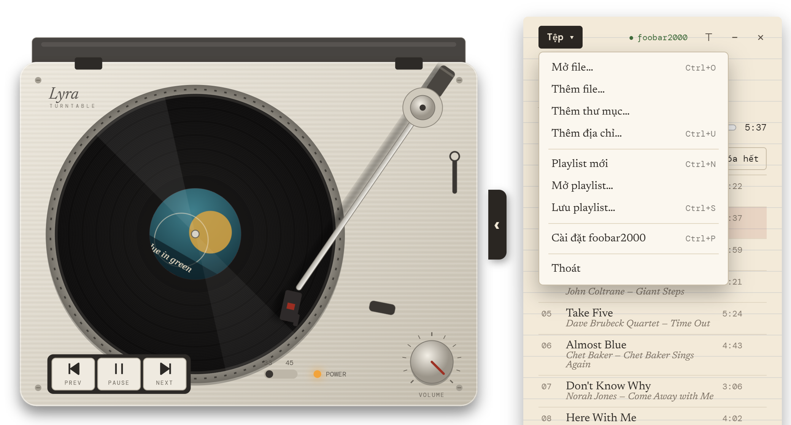

<p align="center">
  
</p>

<h1 align="center"><i>Lyra</i> Turntable</h1>

<p align="center">
  <b>A classic record player for foobar2000.</b> Drop the needle and listen, bit-perfect all the way to your DAC.<br>
  <sub>Tauri v2 · Rust · React · Windows 10/11</sub>
</p>

<p align="center">
  
</p>

| Compact: turntable only | A File menu like foobar2000's |
|:---:|:---:|
|  |  |

**Highlights**
- 🎚️ **Needle drop**: click any groove to seek, and the tonearm follows the track position
- 💿 Album art is printed on the record label; the record spins at 33⅓ while playing and stops on pause
- 📂 *Open with* for FLAC, WAV, ALAC, DSF/DFF…, drag & drop, playlists, and a **File** menu modeled on foobar2000
- 🪶 Frameless window you drag with the left mouse button, plus a ‹ › playlist drawer that slides away
- 🔇 foobar2000 runs fully hidden behind it, and quits with Lyra (only if Lyra started it)

---

## How it works

**Released app (0.3.0):** Lyra is the front end; decoding and audio output are done by foobar2000. Lyra controls foobar2000 through **Beefweb** (a REST API on `localhost:8880`) and through foobar2000's command line. Sections 1–5 describe this version.

**In development: Lyra Engine.** A native Rust audio engine is replacing foobar2000, so that installing Lyra alone gives bit-perfect playback (see [section 7](#7-lyra-engine-in-development)). Until it is finished, the app keeps using foobar2000 through the `FoobarBackend`.

- Tauri v2 (Rust + WebView2), React 18, TypeScript, Vite
- Transparent, frameless window
- Current release: **0.3.0** · engine target: **1.0** (FLAC + DSD, no foobar2000 needed)

> The UI labels are in Vietnamese. This README quotes each label with its English meaning, e.g. **Tệp** (File).

---

## 1. Requirements

| Component | Notes |
|---|---|
| Windows 10/11 x64 | WebView2 is preinstalled |
| foobar2000 v2 x64 | Standard install at `C:\Program Files\foobar2000\foobar2000.exe` (the path is hard-coded in `src-tauri/src/lib.rs`) |
| `foo_beefweb` (0.10+) | **Required**: Lyra talks to foobar2000 through it |
| `foo_out_asio` | Optional: output through your DAC's ASIO driver |
| `foo_input_sacd` | Optional: DSD playback (`.dsf`, `.dff`, SACD `.iso`) |
| `foo_dsd_processor` | Optional: DSD processing/conversion |

### Beefweb settings
foobar2000 → *File › Preferences › Tools › Beefweb Remote Control*:
- **Port**: `8880`
- **Allow remote connections**: off (Lyra only needs `localhost`)
- **Require authentication**: off

---

## 2. Installation

**Option 1: installer**
Run `Lyra Turntable_0.3.0_x64-setup.exe`. It installs for the current user only, to `%LOCALAPPDATA%\Lyra Turntable\lyra.exe`, with no admin rights needed.

**Option 2: build from source**
```powershell
# needs: Node 20+, Rust (msvc), VS Build Tools 2022 (C++ workload + Windows SDK)
npm install
npm run tauri dev     # run in development
npx tauri build       # installer lands in src-tauri\target\release\bundle\nsis\
```
To change the icon, edit `app-icon.svg` and run `npx tauri icon app-icon.svg`.

---

## 3. Playing high-resolution files without losing quality (bit-perfect)

The goal is to deliver **exactly the bits in the file** to the DAC, with no resampling, mixing or digital volume from Windows or any software along the way. Lyra never touches the audio data, so every setting below lives in **foobar2000** and **Windows**.

> Menu names may differ slightly between foobar2000 and component versions.

### 3.1 Use an exclusive output
foobar2000 → *Preferences › Playback › Output*:
- **Device**: pick one of
  - `WASAPI (exclusive) : <your DAC>`: built into Windows, works with any DAC.
  - `ASIO : <your DAC's driver>`: needs `foo_out_asio` and the manufacturer's ASIO driver. Usually more stable, and the only way to play **native DSD**.
- **Output format**: the highest bit depth your DAC supports (24-bit or 32-bit).
- **Buffer length**: around 1000 ms. Raise it if you hear clicks or dropouts.

**Avoid** `Primary Sound Driver` and `DirectSound`. Both go through the Windows mixer, which resamples everything to the system's default sample rate.

### 3.2 Let nothing process the signal
- *Preferences › Playback › DSP Manager*: **leave Active DSPs empty** (no resampler, equalizer or crossfeed).
- *Preferences › Playback › ReplayGain*: **Source mode = none**.
- **Keep foobar2000's volume at 0 dB (maximum).** Lyra's volume knob *is* foobar2000's digital volume: turning it down throws away bits, and playback is no longer bit-perfect. Set the listening level on your DAC or amplifier instead.

### 3.3 Windows
*Control Panel › Sound › <your DAC> › Properties*:
- *Advanced*: enable **Allow applications to take exclusive control of this device**.
- *Enhancements* / *Audio enhancements*: **turn all off**.
- *Spatial sound*: **Off**.

### 3.4 Hi-res PCM (FLAC 24/96, 24/192, WAV, ALAC, AIFF, WavPack, APE)
Nothing else to do. With WASAPI exclusive or ASIO, the DAC switches to each track's native sample rate. Its display or indicator light should change accordingly, e.g. 44.1 → 96 → 192 kHz.

### 3.5 DSD (`.dsf`, `.dff`, SACD `.iso`)
Requires `foo_input_sacd`. Under *Preferences › Tools › SACD* (or *DSD*), **Output Mode** offers three options:

| Mode | When to use | Output |
|---|---|---|
| **PCM** | DAC has no DSD support | Any. DSD is converted to PCM and is no longer native DSD |
| **DSD (DoP)** | DAC supports DoP (most modern USB DACs) | WASAPI exclusive 24-bit, or ASIO |
| **Native DSD** | DAC has an ASIO driver with DSD support | ASIO |

Check: while a DSD file plays, the DAC should show **DSD64**, **DSD128** and so on, not 176.4 kHz PCM. If it shows PCM in DoP mode, the usual cause is a volume below 0 dB or a DSP altering the DoP data.

SACD `.iso` is not in the *Open with* menu. Use **Tệp › Thêm file…** (File › Add files) or drag the file onto Lyra.

### 3.6 Quick checklist
- [ ] Output = WASAPI (exclusive) or ASIO
- [ ] DSP Manager empty, ReplayGain = none
- [ ] foobar2000 / Lyra volume at 0 dB, level set on the DAC
- [ ] Windows: exclusive mode allowed, enhancements off
- [ ] DSD: DoP or native selected, DAC shows DSD

---

## 4. Using Lyra

| Task | How |
|---|---|
| Open a music file | Right-click the file › **Open with › Lyra Turntable**, or **Tệp › Mở file…** (File › Open, Ctrl+O). The file plays in *Default Playlist* |
| Add to the playlist on screen | **Tệp › Thêm file… / Thêm thư mục… / Thêm địa chỉ…** (Add files / Add folder / Add location, Ctrl+U), or drag & drop onto the window |
| Playlists | **Playlist mới** (New playlist, Ctrl+N), **Mở playlist…** (Load), **Lưu playlist…** (Save, Ctrl+S). Switch playlists with the picker above the list. × removes a track, **Xóa hết** (Clear all) empties the list |
| Seek (needle drop) | Click a groove on the record |
| Transport | The PREV / PLAY / NEXT keys and the volume knob (read section 3.2 first) |
| Show/hide the playlist | Click the ‹ / › tab between the turntable and the list |
| Move the window | Press and hold the **left mouse button** on any empty area and drag |
| Pin on top / minimize / close | The three buttons at the top right |
| System tray | Play/Pause, Next, Prev, **Hiện Lyra** (Show Lyra), show/hide foobar2000, Quit |
| foobar2000 settings | **Tệp › Cài đặt foobar2000** (File › foobar2000 Preferences, Ctrl+P) |

### How Lyra handles foobar2000
- If foobar2000 is **not running**, Lyra starts it and **fully hides** its window. Closing Lyra also closes foobar2000.
- If foobar2000 is **already running** (you opened it yourself), Lyra shares it and does **not** close it on exit.

### Default Playlist
- On startup, *Default Playlist* is emptied, **unless** you added tracks to it yourself or it is currently playing.
- Files opened via *Open with* or **Tệp › Mở file…** always go to *Default Playlist* and start playing.

---

## 5. Troubleshooting

| Symptom | Check |
|---|---|
| Lyra can't connect | Is foobar2000 running? Is Beefweb enabled on port 8880? Try opening `http://localhost:8880/api/player` |
| Lyra is missing from *Open with* | Launch Lyra once (it registers on first run). Lyra never makes itself the default app |
| The old icon still shows | Windows icon cache. Sign out and back in |
| Clicks or dropouts in exclusive mode | Increase Buffer length, or use ASIO if your DAC has a driver |
| DAC doesn't change sample rate | You are on DirectSound/Primary, or a resampler is in the DSP chain. Review section 3. On a laptop, also check which rates the built-in output accepts (section 7.3) |
| Sound is "wider", louder or coloured | Windows *Audio enhancements* or *Spatial sound* (e.g. Dolby Atmos) is on. Turn both **Off** for the output device |

---

## 6. Project layout

```
src/                     React UI
  App.tsx                window shell, File menu, playlists, drawer, window drag, Open-with
  Turntable.tsx          SVG turntable (record, tonearm, keys, volume knob)
  backend/
    PlayerBackend.ts     the interface the UI talks to (ADR-001)
    FoobarBackend.ts     today's backend: Beefweb calls, polls foobar2000 every second
  styles.css
src-tauri/               Tauri app shell
  src/lib.rs             foobar2000 lifecycle, window hiding (Win32), tray,
                         single instance, Open-with registration (HKCU)
  tauri.conf.json, capabilities/default.json
crates/                  Lyra Engine (Rust, one crate per service)
  lyra-core              shared types, traits, events (S01)
  lyra-decode            FLAC/WAV decoding, sample-accurate seek (S02)        ✅ P1
  lyra-output            WASAPI exclusive/shared output, device tap (S04)    ✅ P2 code
  lyra-dsd               DSF/DFF, DoP, DSD→PCM (S03)                         ⏳ P5
  lyra-engine            transport, queue, gapless, routing (S05)            ⏳ P3
  lyra-library           tags, artwork, cue, playlists (S06)                 ⏳ P3/P4/P6
  lyra-plugin            plugin ABI, foobar2000 bridge (S07)                 after 1.0
tools/
  lyra-probe             QA CLI: decode / compare / align / capture / meta / mute
  lyra-play              headless player: --probe, --tap, exclusive/shared
tests/parity/            QA harness vs foobar2000 (golden.ps1, run.ps1, p1.ps1, synth.ps1, fb2k_meta.ps1)
.claude/agents/          the 10 lyra-* Claude Code subagents that build the engine
docs/
  images/, capture/      README screenshots and the script that re-renders them
  BACKLOG-polish.md      small finishing touches, parked on purpose
  PLAN-replace-foobar2000.md   first one-page plan (superseded, see section 7.4)
```

`Cargo.toml` at the root is a workspace containing `src-tauri`, `crates/*` and `tools/*`.

To refresh the screenshots after a UI change: run `npx vite --port 1420`, then `python docs/capture/capture.py` (needs `pip install playwright`; the script uses the Edge that ships with Windows, and ffmpeg to build the GIF). The album art and track list in the screenshots are sample data.

---

## 7. Lyra Engine (in development)

### 7.1 Goal
**1.0 = FLAC, WAV, DSF and DFF, played bit-perfect by Lyra alone, with no foobar2000
installed.** Quality comes from three things Lyra does itself: an exact decoder
(cross-checked against libFLAC, the decoder foobar2000 ships), an output path that
never touches samples (WASAPI exclusive / ASIO), and correct DSD handling. Three DSD
paths are chosen automatically from what the device supports: **native DSD over ASIO**,
**DoP**, or **DSD→PCM**. Other formats (ALAC, MP3, AAC, Opus, APE…) and loading
foobar2000 components come after 1.0.

A bit-perfect engine can match foobar2000, not beat it; the goal is to *prove* it
matches, file by file.

### 7.2 Progress

| Phase | What | Status |
|---|---|---|
| P0 | Workspace, contracts, test harness, golden references (82/82 corpus files) | ✅ passed |
| P1 | FLAC + WAV decode | ✅ QA passed: **78/78 lossless files bit-identical** to libFLAC, exact lengths, broken-artwork files OK, no panics on corrupt input |
| P2 | WASAPI exclusive output + device tap | 🔄 code merged, render tests and review pending |
| P5 | DSD: DSF/DFF, DoP, native ASIO, DSD→PCM | ⏳ |
| P3 | Engine: queue, gapless, seek, cue | ⏳ |
| P4 | App alpha: native backend selectable in the UI, bit-perfect badge | ⏳ |
| P6 | Metadata parity with foobar2000 | ⏳ |
| P8 | Certification (parity, 2 h soak, runs without foobar2000) → **1.0** | ⏳ |

### 7.3 Hardware notes
Bit-perfect only works at rates the output device accepts. On the development laptop
(built-in Senary codec): **Speakers accept only 48 kHz; Headphones accept 48 and
96 kHz** (no 44.1). There, 48/96 kHz files play bit-perfect; other rates go through a
high-quality resampler and the UI says so. 44.1/192 kHz bit-perfect and native DSD need
an external USB DAC with an ASIO driver. Check your device in *Settings › System ›
Sound › (device) › Properties › Format*, or run:

```powershell
cargo build --release -p lyra-play
target\release\lyra-play.exe --probe      # lists every device's exclusive-mode formats
```

### 7.4 How it is built
The engine is built by Claude Code subagents (`.claude/agents/lyra-*`), one per service,
with an independent QA agent that compares every result with foobar2000 and a reviewer
that gates each phase. The full plan (architecture, ADRs, phase files, test strategy,
runbook) lives outside this repo in Hoai's `learning_code/lyra-engine` folder.

Useful commands:

```powershell
cargo test --workspace                     # unit tests for all crates
cargo clippy --workspace -- -D warnings
target\release\lyra-probe.exe decode <file.flac>   # decode + SHA-256 + spec as JSON
target\release\lyra-probe.exe compare <a> <b>      # bit-exact or tolerance compare
tests\parity\run.ps1 -Phase P1             # parity suite for a phase → target\parity\reports\
```

The test corpus is read-only; generated audio, golden decodes and reports stay under
`target/` and are never committed.
