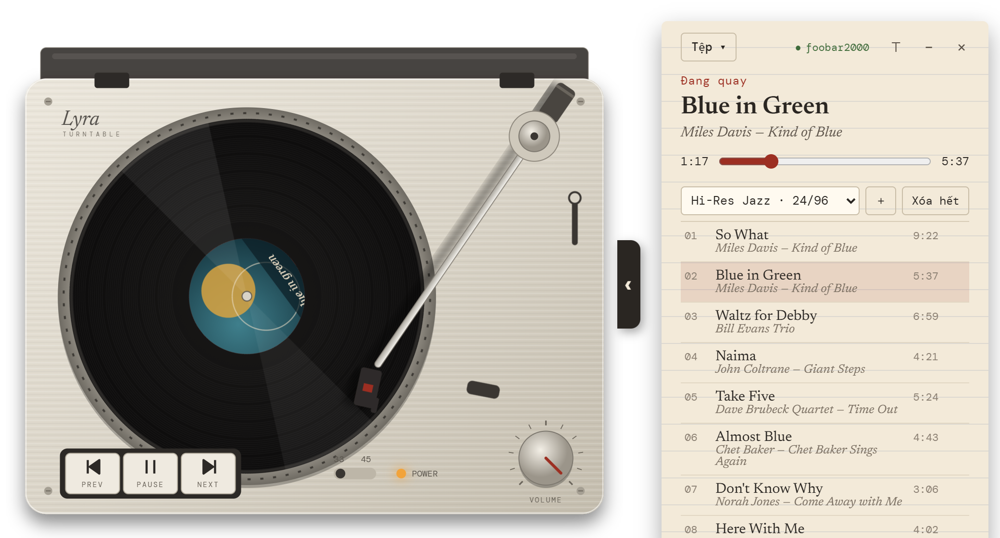
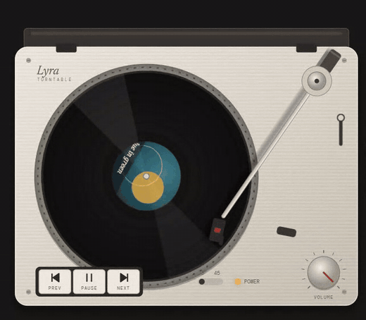
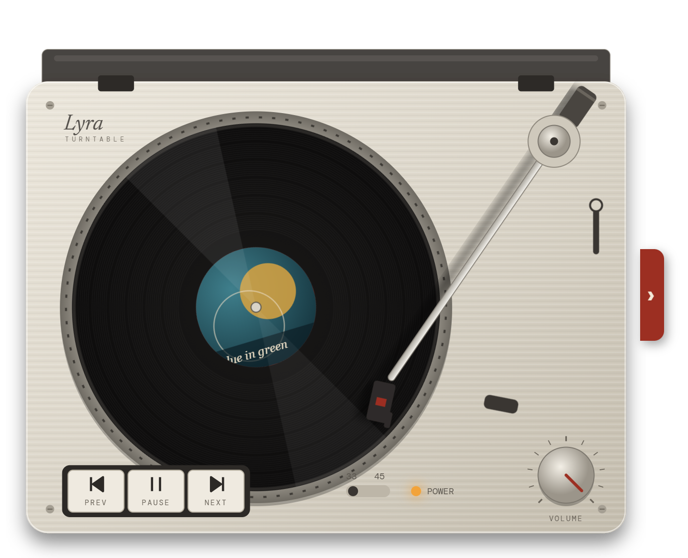

<p align="center">
  
</p>

<h1 align="center"><i>Lyra</i> Turntable</h1>

<p align="center">
  <b>A classic record player with its own bit-perfect audio engine.</b> Drop the needle and listen — Lyra decodes and plays your files all the way to the DAC, untouched. No foobar2000 required.<br>
  <sub>Tauri v2 · Rust · React · Windows 10/11</sub>
</p>

<p align="center">
  
</p>

| Compact: turntable only | A File menu like foobar2000's |
|:---:|:---:|
|  |  |

**Highlights**
- 🎛️ **Standalone engine**: Lyra's own Rust decoders feed a WASAPI-exclusive / ASIO output. Install Lyra alone — nothing else — and playback is bit-perfect.
- 🎚️ **Needle drop**: click any groove to seek, and the tonearm follows the track position
- 💿 Album art is printed on the record label; the record spins at 33⅓ while playing and stops on pause
- 🟢 A **bit-perfect badge** on the turntable shows the exact path, e.g. `FLAC 24/96 → 24/96 ✓`. The volume knob locks at 0 dB while bit-perfect, with a tooltip saying why
- 📂 *Open with* for FLAC, WAV and DSD (`.dsf`/`.dff`), drag & drop, playlists, and a **File** menu modeled on foobar2000
- 🪶 Frameless window you drag with the left mouse button, plus a ‹ › playlist drawer that slides away

---

## How it works

**Lyra 1.0 is a standalone player.** Its own Rust audio engine (the *Lyra Engine*)
decodes the file and sends the samples to the DAC through **WASAPI exclusive** or
**ASIO**, without resampling, mixing or digital volume along the way. foobar2000 is
**not installed, launched or required**.

foobar2000 still exists as a **hidden "Advanced / Legacy" backend** for anyone who
specifically wants the old path, but a fresh user never touches it: the native engine
is the default and only normal backend.

- Tauri v2 (Rust + WebView2), React 18, TypeScript, Vite
- Transparent, frameless window
- Current release: **1.0.0** — FLAC, WAV and DSD (DSF/DFF), bit-perfect, no foobar2000 needed

> The UI labels are in Vietnamese. This README quotes each label with its English meaning, e.g. **Tệp** (File). The strings live in one table (`src/strings.ts`) so an English/Vietnamese toggle can be added later.

---

## 1. Requirements

| Component | Notes |
|---|---|
| Windows 10/11 x64 | WebView2 is preinstalled. No other software needed for playback |
| A DAC (optional but recommended) | Any WASAPI device works; a USB DAC with an **ASIO** driver is the most stable path and the only way to play **native DSD** |

**foobar2000 is not required.** It is only consulted if you deliberately switch to the
hidden legacy backend (see [Settings](#4-using-lyra)); even then Lyra starts it hidden
and closes it only if Lyra started it.

---

## 2. Installation

**Option 1: installer**
Run `Lyra Turntable_1.0.0_x64-setup.exe`. It installs for the current user only, to
`%LOCALAPPDATA%\Lyra Turntable\lyra.exe`, with no admin rights needed.

On first launch Lyra does a **one-time, read-only import** of any foobar2000 v2
playlists it finds (`%APPDATA%\foobar2000-v2\playlists-v2.0\`) so returning users keep
their lists. Your foobar2000 files are never modified.

**Option 2: build from source**
```powershell
# needs: Node 20+, Rust (msvc), VS Build Tools 2022 (C++ workload + Windows SDK)
npm install
npm run tauri dev     # run in development
npx tauri build       # installer lands in src-tauri\target\release\bundle\nsis\
```
To change the icon, edit `app-icon.svg` and run `npx tauri icon app-icon.svg`.

---

## 3. Playing high-resolution files without losing quality (bit-perfect)

The goal is to deliver **exactly the bits in the file** to the DAC, with no resampling,
mixing or digital volume from Windows or any software along the way. Lyra's engine never
touches the audio data; the only things that can degrade it live in **Lyra's Settings**
and in **Windows**.

Lyra shows a **bit-perfect badge** on the turntable while it plays: green with a `✓`
means the samples reached the output API unchanged (e.g. `FLAC 24/96 → 24/96 ✓`), amber
with a `✗` means the device forced a conversion (e.g. `→ shared 48k ✗`).

> Bit-perfect is proven to the **WASAPI / ASIO API boundary** on this hardware — the bits
> Lyra hands the output API match the file. What the DAC does after that is up to the DAC.

### 3.1 Choose an exclusive output (Lyra ⚙ Settings)
Open **Cài đặt** (Settings, the ⚙ button):
- **Output device**: pick your DAC. The list shows each device's highest exclusive-mode rate.
- **Output mode**:
  - **Exclusive** (WASAPI exclusive): built into Windows, works with any DAC, bit-perfect.
  - **ASIO**: needs the manufacturer's ASIO driver. Usually more stable, and the only way to play **native DSD**.
  - **Shared**: goes through the Windows mixer (not bit-perfect) — only for troubleshooting.
- **DSD routing**: **Auto** picks native DSD / DoP / PCM from what the device supports (see 3.4).

### 3.2 Volume stays at 0 dB
In bit-perfect mode the **volume knob is locked at 0 dB** — turning it down would throw
away bits. The knob shows a tooltip explaining this. Set the listening level on your DAC
or amplifier instead. (Lyra does no DSP, resampling or ReplayGain of its own, so there is
nothing else to switch off inside the app.)

### 3.3 Windows
*Control Panel › Sound › <your DAC> › Properties*:
- *Advanced*: enable **Allow applications to take exclusive control of this device**.
- *Enhancements* / *Audio enhancements*: **turn all off**.
- *Spatial sound* (e.g. Dolby Atmos): **Off**.

Windows audio enhancements and spatial sound colour or re-mix the signal; keep them off
for faithful playback.

### 3.4 Hi-res PCM and DSD

**PCM (FLAC, WAV — 44.1 up to 192 kHz, 16/24-bit):** nothing else to do. With WASAPI
exclusive or ASIO the DAC switches to each track's native sample rate; its display or
indicator light should change accordingly, e.g. 44.1 → 96 → 192 kHz.

**DSD (`.dsf`, `.dff` — uncompressed DSD):** Lyra picks the route automatically from the
device:

| Route | When it is used | Output |
|---|---|---|
| **Native DSD** | DAC has an ASIO driver with DSD support | ASIO, raw DSD |
| **DSD (DoP)** | DAC supports DoP over WASAPI exclusive | WASAPI exclusive, 24-bit |
| **DSD → PCM** | DAC has no DSD support | DSD converted to high-rate PCM |

Check: while a DSD file plays, a DSD-capable DAC should show **DSD64**, **DSD128** and so
on. On a DAC with no DSD support, Lyra converts to PCM and the badge says so.

### 3.5 Quick checklist
- [ ] Output mode = Exclusive or ASIO (not Shared)
- [ ] Output device = your DAC
- [ ] Volume at 0 dB (it is locked there), level set on the DAC
- [ ] Windows: exclusive mode allowed, enhancements and spatial sound off
- [ ] Badge is green `✓` while playing

---

## 4. Using Lyra

| Task | How |
|---|---|
| Open a music file | Right-click the file › **Open with › Lyra Turntable**, or **Tệp › Mở file…** (File › Open, Ctrl+O). The file plays in *Default Playlist* |
| Add to the playlist on screen | **Tệp › Thêm file… / Thêm thư mục… / Thêm địa chỉ…** (Add files / Add folder / Add location, Ctrl+U), or drag & drop onto the window |
| Playlists | **Playlist mới** (New playlist, Ctrl+N), **Mở playlist…** (Load), **Lưu playlist…** (Save, Ctrl+S). Switch playlists with the picker above the list. × removes a track, **Xóa hết** (Clear all) empties the list |
| Seek (needle drop) | Click a groove on the record |
| Transport | The PREV / PLAY / NEXT keys and the volume knob (locked at 0 dB while bit-perfect — read section 3.2) |
| Show/hide the playlist | Click the ‹ / › tab between the turntable and the list |
| Move the window | Press and hold the **left mouse button** on any empty area and drag |
| Pin on top / minimize / close | The three buttons at the top right |
| Settings | The ⚙ **Cài đặt** (Settings) button: backend, output device, output mode, DSD routing |
| System tray | Play/Pause, Next, Prev, **Hiện Lyra** (Show Lyra), Quit |

### Settings: backend
The default — and only normal — backend is **Lyra (bit-perfect)**, the native engine.
foobar2000 lives under **Nâng cao / cũ** (Advanced / Legacy) and is there only if you
specifically need the old path; it requires foobar2000 to be installed. Switching
backends never lets two players make sound at once — Lyra stops the one you leave first.

### Default Playlist
- On startup, *Default Playlist* is emptied, **unless** you added tracks to it yourself or it is currently playing.
- Files opened via *Open with* or **Tệp › Mở file…** always go to *Default Playlist* and start playing.

### Legacy foobar2000 backend (optional)
If you switch to the legacy backend:
- If foobar2000 is **not running**, Lyra starts it and **fully hides** its window. Closing Lyra also closes foobar2000.
- If foobar2000 is **already running** (you opened it yourself), Lyra shares it and does **not** close it on exit.
- Bit-perfect then depends on foobar2000's own Output / DSP / ReplayGain settings, as in older Lyra releases.

---

## 5. Supported formats

**1.0 (shipping):** FLAC, WAV, and DSD — `.dsf` and `.dff` (uncompressed DSD). All
bit-perfect, decoded by Lyra itself.

**After 1.0:** ALAC, AIFF, MP3, AAC, Vorbis, Opus, WavPack and APE, plus the ability to
load foobar2000 components as an optional bridge, are planned but **not in 1.0**. Until
then, those formats only play through the legacy foobar2000 backend.

---

## 6. Troubleshooting

| Symptom | Check |
|---|---|
| Badge is amber `✗` / "shared" | You are in Shared output mode, or the device rejected the file's rate in exclusive mode. Set mode = Exclusive or ASIO, and confirm the device accepts the rate (section 3.1) |
| DAC doesn't change sample rate | You are in Shared mode. Switch to Exclusive or ASIO. On a laptop, also check which rates the built-in output accepts (section 7.2) |
| Clicks or dropouts in exclusive mode | Use ASIO if your DAC has a driver; some devices are happier there |
| DSD plays as PCM | Your DAC has no DSD support, so Lyra uses DSD→PCM. For native DSD/DoP you need a DSD-capable DAC (section 7) |
| Sound is "wider", louder or coloured | Windows *Audio enhancements* or *Spatial sound* (e.g. Dolby Atmos) is on. Turn both **Off** for the output device |
| Lyra is missing from *Open with* | Launch Lyra once (it registers on first run). Lyra never makes itself the default app |
| The old icon still shows | Windows icon cache. Sign out and back in |

---

## 7. The Lyra Engine

Lyra 1.0's audio is its own Rust engine, built as a Cargo workspace of small services.
Quality comes from three things Lyra does itself: exact decoders (FLAC cross-checked
bit-for-bit against libFLAC), an output path that never touches samples (WASAPI exclusive
/ ASIO), and correct DSD handling (native DSD over ASIO, DoP over WASAPI, or DSD→PCM,
chosen automatically from the device).

A bit-perfect engine can match a reference player, not beat it; the goal was to *prove*
it matches, file by file — which it now does for FLAC and WAV against libFLAC.

### 7.1 What is proven, and what is pending hardware
- **FLAC + WAV:** bit-identical to libFLAC across the test corpus; bit-perfect to the WASAPI / ASIO API boundary on this machine.
- **DSD → PCM:** works on the development laptop (built-in Senary codec, no DSD DAC), so DSD files are playable everywhere.
- **Native DSD over ASIO** and **DoP over WASAPI** are implemented and unit-tested, but their end-to-end hardware verification is **pending a DSD-capable DAC** — the dev laptop cannot output raw DSD. See the release notes for the full pending list.

### 7.2 Hardware notes
Bit-perfect only works at rates the output device accepts. On the development laptop
(built-in Senary codec): **Speakers accept only 48 kHz; Headphones accept 48 and
96 kHz** (no 44.1). There, 48/96 kHz files play bit-perfect and the badge shows it;
other rates fall back to shared mode and the badge turns amber. 44.1/192 kHz bit-perfect
and native DSD need an external USB DAC (ASIO for native DSD). Check your device in
*Settings › System › Sound › (device) › Properties › Format*.

### 7.3 How it is built
The engine is built by Claude Code subagents (`.claude/agents/lyra-*`), one per service,
with an independent QA agent that compares every result against a reference and a
reviewer that gates each phase. The full plan (architecture, ADRs, phase files, test
strategy, runbook) lives outside this repo in the `learning_code/lyra-engine` folder.

Useful commands:

```powershell
cargo test --workspace                     # unit tests for all crates
cargo clippy --workspace -- -D warnings
target\release\lyra-probe.exe decode <file.flac>   # decode + SHA-256 + spec as JSON
target\release\lyra-probe.exe compare <a> <b>      # bit-exact or tolerance compare
target\release\lyra-play.exe --probe               # list every device's exclusive-mode formats
```

The test corpus is read-only; generated audio, golden decodes and reports stay under
`target/` and are never committed.

---

## 8. Project layout

```
src/                     React UI
  App.tsx                window shell, File menu, playlists, drawer, window drag, Open-with
  Turntable.tsx          SVG turntable (record, tonearm, keys, volume knob)
  Settings.tsx           ⚙ panel: backend, output device, output mode, DSD routing
  Badge.tsx              bit-perfect status pill on the turntable
  strings.ts             UI string table (Vietnamese today; English table alongside)
  backend/
    PlayerBackend.ts     the interface the UI talks to (ADR-001)
    NativeBackend.ts     default backend: drives the Lyra Engine
    FoobarBackend.ts     hidden legacy backend: Beefweb + foobar2000 command line
  styles.css
src-tauri/               Tauri app shell
  src/lib.rs             native engine wiring, legacy foobar2000 lifecycle, window hiding
                         (Win32), tray, single instance, Open-with registration (HKCU)
  src/engine.rs, library.rs, settings.rs, volume.rs
  tauri.conf.json, capabilities/default.json
crates/                  Lyra Engine (Rust, one crate per service)
  lyra-core              shared types, traits, events (S01)
  lyra-decode            FLAC/WAV decoding, sample-accurate seek (S02)
  lyra-output            WASAPI exclusive/shared output, device tap (S04)
  lyra-dsd               DSF/DFF, DoP, DSD→PCM (S03)
  lyra-engine            transport, queue, gapless, routing (S05)
  lyra-library           tags, artwork, cue, playlists (S06)
  lyra-plugin            plugin ABI, foobar2000 bridge (post-1.0)
tools/
  lyra-probe             QA CLI: decode / compare / align / capture / meta / mute
  lyra-play              headless player: --probe, --tap, exclusive/shared
tests/parity/            QA harness (golden.ps1, run.ps1, p1.ps1, synth.ps1, fb2k_meta.ps1)
.claude/agents/          the lyra-* Claude Code subagents that build the engine
docs/
  images/, capture/      README screenshots and the script that re-renders them
  BACKLOG-polish.md      small finishing touches, parked on purpose
CHANGELOG.md             release notes
```

`Cargo.toml` at the root is a workspace containing `src-tauri`, `crates/*` and `tools/*`.

To refresh the screenshots after a UI change: run `npx vite --port 1420`, then
`python docs/capture/capture.py` (needs `pip install playwright`; the script uses the
Edge that ships with Windows, and ffmpeg to build the GIF). The album art and track list
in the screenshots are sample data.
